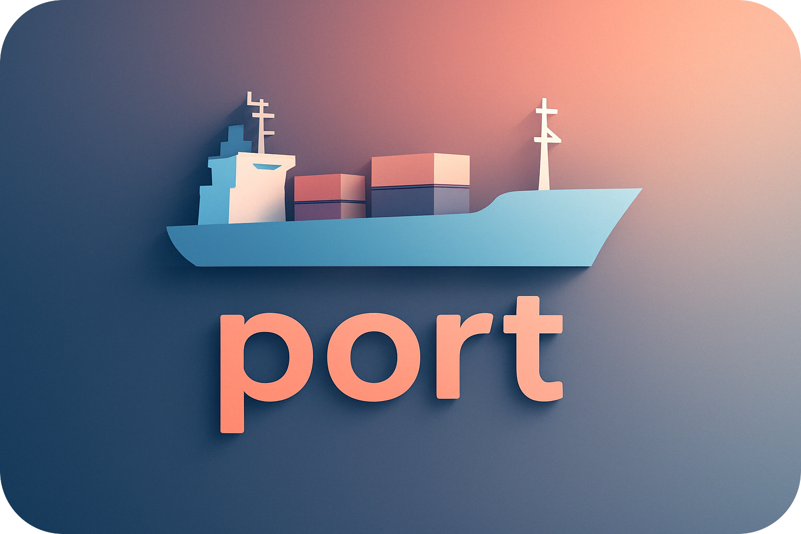
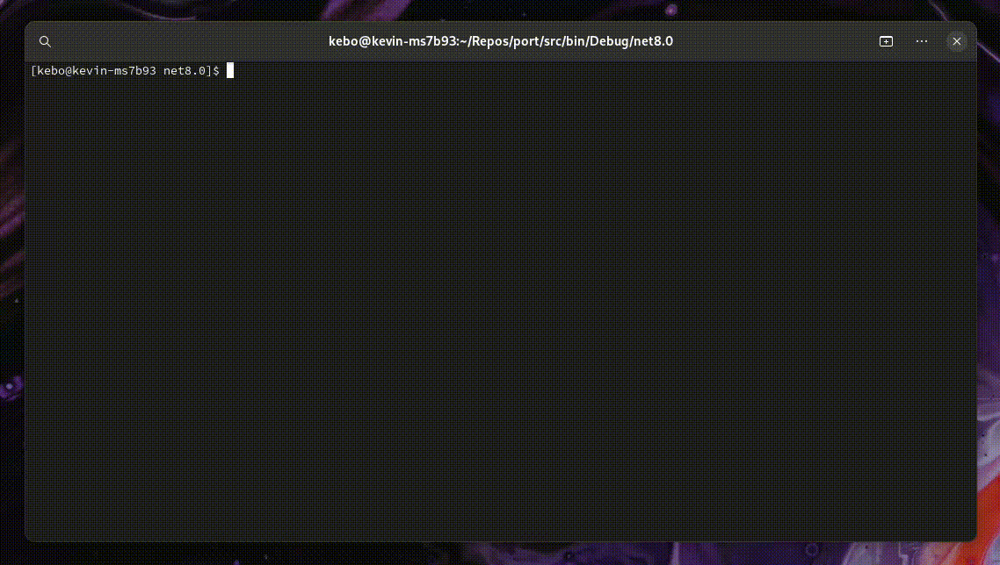

<p align="center">
  
</p>

<p align="center">
  A small CLI for running and snapshotting Docker containers from a YAML config &mdash; with an MCP server so AI agents can drive the same workflows.
</p>

<p align="center">
  
  <a href="https://github.com/kevinboss/maple"></a>
  <a href="https://github.com/microsoft/winget-pkgs/tree/master/manifests/k/kevinboss/port"></a>
  <a href="https://github.com/kevinboss/port/actions/workflows/ci.yaml"></a>
  <a href="LICENSE"></a>
  <a href="https://github.com/kevinboss/heartbeat"></a>
</p>

> This project is being developed using AI development tools. However, every line of code is reviewed and approved by a human before being committed.

<p align="center">
  
</p>

`port` runs and snapshots Docker containers from a YAML config (`~/.port` on
Linux and macOS, `%USERPROFILE%\.port` on Windows) and merges in a local
`docker-compose.yml` when present. You refer to images by short identifiers
instead of full Docker names, and launching a container stops any other
container holding the same host port first. The same workflows are exposed over
stdio through `port mcp` so AI agents can drive containers with the
[Model Context Protocol](https://modelcontextprotocol.io).

Install with Scoop:

```powershell
scoop bucket add maple 'https://github.com/kevinboss/maple.git'
scoop install port
```

Or with winget:

```powershell
winget install kevinboss.port
```

Or download a binary from the
[releases page](https://github.com/kevinboss/port/releases) and put it on your
`PATH`.

First run creates `~/.port` with a `Getting.Started` entry:

```bash
port config --open                  # open ~/.port in your editor
port list                           # list images, snapshots, and containers
port run Getting.Started:latest     # launch a container
port commit Getting.Started.latest  # snapshot the running container
port reset Getting.Started.latest   # discard changes and recreate it
port stop Getting.Started.latest    # stop the container
```

See [commands](docs/commands.md), [configuration](docs/configuration.md), and
[MCP server](docs/mcp.md) for all flags, Compose setup, and agent integration.

## How to contribute

Pull requests are welcome. See [CONTRIBUTING.md](CONTRIBUTING.md) for
prerequisites, build and test commands, and repository layout.
